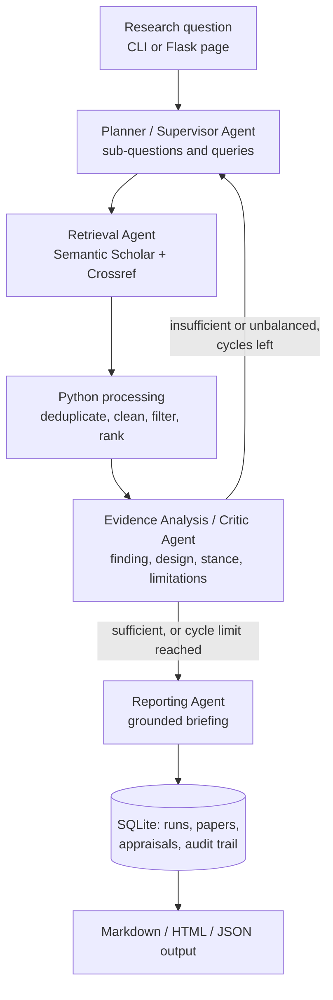

# Academic Evidence Investigator

An LLM-powered multi-agent system that takes a research question, plans a search strategy, retrieves scholarly papers, appraises the evidence, and produces a structured, referenced research briefing. If the evidence is too thin or one-sided, it searches again with a revised plan.

This is the individual implementation of the Unit 6 group design proposal *Design Proposal for an LLM-Powered Multi-Agent Academic Evidence Investigator* (Perera, Unal, Shalaan and Torres Zambrano), submitted for Unit 11 of the Intelligent Agents module.

## 1. Purpose

Postgraduate researchers spend a lot of time refining questions, finding literature, judging evidence quality and synthesising findings. The Investigator supports that work for a Graduate School or Postgraduate Research Support Unit. It **supports rather than replaces** the researcher: every finding links to a retrieved source, every run keeps an audit trail, and "research opportunities" are framed only as gaps *within the retrieved papers*.

## 2. How it works



| Agent | Responsibility | LLM role | Deterministic safeguard |
|---|---|---|---|
| Planner / Supervisor (`agents/planner.py`) | Decomposes the question, writes queries, re-plans from critic feedback | Proposes a JSON plan | Pydantic validation, query de-duplication, keyword fallback plan |
| Retrieval (`agents/retrieval.py`) | Runs every query on every source | None | Per-source error isolation, rate limiting, retry on transient errors only |
| Processing (`processing.py`) | Deduplicates by DOI then title + first author, drops records without abstracts, ranks by relevance | None (by design) | pandas table operations, logged counts |
| Critic (`agents/critic.py`) | Appraises each paper and decides whether evidence is sufficient, relevant and balanced | Appraises abstracts (batched, new papers only) | Hallucinated paper ids discarded; the stop/re-plan decision uses explicit thresholds, not the LLM |
| Reporting (`agents/reporter.py`) | Writes the briefing and stores it | Drafts the briefing | Every finding must cite a retrieved paper; evidence status written by Python |

The agents share one `ResearchState` (`state.py`) and are wired as a LangGraph `StateGraph` (`graph.py`) with a conditional edge from the Critic back to the Planner. The loop is bounded by `MAX_CYCLES` (default 3) and by LangGraph's recursion limit as a backstop.

### Design traceability

| Proposal commitment (Unit 6) | Where it is implemented |
|---|---|
| Supervisor-based architecture with four specialist roles (s.3) | `agents/`, `graph.py` |
| LangGraph shared state and conditional workflow (s.2, s.3) | `state.py`, `graph.py` |
| Qwen2.5-7B-Instruct via Hugging Face, model configurable (s.2) | `llm.py`, `HF_MODEL` and `LLM_BASE_URL` settings |
| Semantic Scholar and Crossref (s.2) | `sources/semantic_scholar.py`, `sources/crossref.py` |
| Deterministic deduplication, cleaning and ranking (s.3) | `processing.py` |
| Critic returns control to the Planner if evidence is weak or unbalanced (s.3, Fig. 2) | `CriticAgent.judge`, `make_router` |
| Fixed JSON schema for intermediate outputs (s.5) | `schemas.py` (Pydantic) |
| Audit trail of searches, papers retained and re-plan reasons (s.5) | `AuditEvent`, `storage.py`, briefing page |
| Maximum number of search cycles (s.5) | `Settings.max_cycles`, `route_after_critic` |
| DOI, title and author matching for duplicates (s.6) | `processing.process` |
| Filter papers before LLM analysis to manage cost (s.6) | `max_papers_for_analysis`; critic appraises only new papers |
| Findings linked to sources and checked (s.6) | `reporter.ground`, critic id check |
| SQLite persistence, Flask/HTML interface (s.2) | `storage.py`, `web/` |
| PyTest, Git/GitHub (s.2) | `tests/`, commit history |

**Deliberate differences from the proposal.** Only `requests` is used for HTTP (HTTPX added nothing for synchronous calls). An explicit **offline mode** was added so that tests and demonstrations do not depend on network access or API limits; it is never used as a silent fallback for a failed live search, because mixing demo data into a real briefing would misrepresent the evidence. The LLM endpoint is **configurable** (Hugging Face by default, or a local Ollama server), because free-tier model availability changed during development. Every LLM step has a **deterministic fallback**, so the system still completes when the free tier is rate-limited or no token is set. PostgreSQL remains future work.

## 3. Installation

Requires Python 3.11 or later.

```bash
git clone <this repository>
cd evidence-investigator
python -m venv .venv
source .venv/bin/activate        # Windows: .venv\Scripts\activate
pip install -r requirements.txt
```

Optional configuration (copy `.env.example` and set the values in your shell or a git-ignored `.env`):

| Variable | Purpose |
|---|---|
| `HF_TOKEN` | Hugging Face access token (free account, "Make calls to Inference Providers" permission). Without it the agents use their deterministic fallbacks. |
| `HF_MODEL` | Defaults to `Qwen/Qwen2.5-7B-Instruct`. |
| `LLM_BASE_URL` | Any OpenAI-compatible endpoint. Defaults to the Hugging Face router; set `http://localhost:11434/v1` to use Ollama (below). |
| `LLM_TIMEOUT` | Seconds per LLM call (default 90). A local model on a CPU needs more, e.g. 900. |
| `CROSSREF_MAILTO` | Your email, which puts requests in Crossref's "polite pool". |
| `MAX_CYCLES`, `MIN_RELEVANT_PAPERS` | Tune the critic loop. |

**Running the model locally with Ollama (no token, no cost).** Hugging Face's free tier changes: during development Qwen2.5-7B-Instruct stopped being offered on the router and the free credit ran out (remediation R6 in `docs/TESTING.md`). The same model can run on your own machine instead:

```bash
# install Ollama from https://ollama.com/download, then
ollama pull qwen2.5:7b
export LLM_BASE_URL=http://localhost:11434/v1 HF_MODEL=qwen2.5:7b LLM_TIMEOUT=900
# Windows PowerShell: $env:LLM_BASE_URL="http://localhost:11434/v1"; $env:HF_MODEL="qwen2.5:7b"; $env:LLM_TIMEOUT="900"
```

The Critic sends up to 12 abstracts at once, so set Ollama's context length to at least 16k (Ollama settings, or `OLLAMA_CONTEXT_LENGTH=16384`).

## 4. Running

**Command line**

```bash
# Live: Semantic Scholar + Crossref, with the LLM if HF_TOKEN is set
python -m evidence_investigator "Does generative AI improve university students' academic performance?" -v --out briefing.md

# Offline demo: bundled corpus, no LLM, no network, fully reproducible
python -m evidence_investigator "How do LLM-based agents plan, act and reflect?" --offline -v
```

`-v` prints the audit trail (each agent's action per cycle) to the terminal.

**Web interface**

```bash
python -m evidence_investigator.web.app
# open http://127.0.0.1:5000
```

Enter a question, optionally tick *Offline demo mode*, and press **Investigate**. Each run is stored, appears under *Previous runs*, and can be downloaded as JSON from its briefing page.

## 5. Testing

```bash
python -m pytest -v --cov=evidence_investigator      # 79 tests, no network needed
RUN_LIVE_TESTS=1 python -m pytest tests/test_live.py  # optional: real APIs and the configured LLM
```

Unit tests cover each agent, source parser, processing rule, renderer and store. Functional tests run the whole LangGraph workflow with scripted fakes to prove the behaviours the proposal promised: the re-plan loop, the cycle limit, source outages, cross-source deduplication, a full LLM path with a hallucinated citation removed, and graceful degradation when every LLM call fails. Interface tests drive the CLI and the Flask app, including HTML-escaping of hostile text from an API.

The test strategy, results (97% line coverage) and the **remediation log** of the issues testing found and how they were fixed are in [`docs/TESTING.md`](docs/TESTING.md).

## 6. Evidence of execution

| File | Shows |
|---|---|
| `evidence/run-offline-one-cycle.log`, `evidence/briefing-offline-one-cycle.md` | A run judged sufficient after one cycle |
| `evidence/run-offline-max-cycles.log`, `evidence/briefing-offline-max-cycles.md` | The critic forcing two re-plans, then stopping at the cycle limit and labelling the briefing provisional |
| `evidence/run-invalid-input.log` | Input validation (exit code 2) |
| `evidence/test-report.txt` | Full test run with coverage |
| `evidence/test-run-1-before-remediation.txt` | The first coverage run, with the warnings that led to fix R3 |
| `evidence/screenshots/` | The Flask interface: form, briefing, audit trail, cycle-limit briefing, validation error, run history |

`scripts/capture_evidence.sh` regenerates the logs and test report; `scripts/capture_screenshots.py` regenerates the screenshots.

## 7. Project structure

```
evidence_investigator/
  agents/            planner, retrieval, critic, reporter
  sources/           Semantic Scholar, Crossref, offline corpus, rate limiting
  data/              offline demo corpus
  web/               Flask app, templates, stylesheet
  config.py          settings from environment variables
  schemas.py         Pydantic message schemas
  state.py           LangGraph shared research state
  graph.py           workflow wiring and routing
  processing.py      deduplicate, filter, rank
  llm.py             OpenAI-compatible LLM client (Hugging Face or Ollama) and JSON validation
  rendering.py       Harvard references and Markdown
  storage.py         SQLite persistence
  investigator.py    composition root
  cli.py             command line
tests/               unit, functional, interface and live tests, synthetic fixtures
evidence/            execution logs, briefings, test reports, screenshots
docs/TESTING.md      test strategy, results, remediation log
presentation/        10-slide deck (.pptx and .pdf) and narration transcript
```

## 8. Legal, social, ethical and professional considerations

- **Hallucination and over-trust.** Findings must cite retrieved papers, invented citations are stripped, appraisal method (LLM or heuristic) is shown, and the evidence status says plainly when the cycle limit was hit. The interface states that the tool supports and does not replace reading the sources.
- **Bias and coverage.** Two sources, design-targeted queries and an explicit balance check reduce one-sided retrieval, but coverage is limited to what the free APIs index and to papers with abstracts.
- **Provider terms.** Requests are rate-limited, identify the client by User-Agent, use Crossref's polite pool when an email is supplied, and permanent errors are not retried.
- **Security and privacy.** Tokens are read from the environment and never logged or stored; only the question and public bibliographic metadata are saved; the web app binds to localhost and relies on Jinja2 autoescaping for untrusted text.
- **Academic integrity.** The offline corpus lists real papers with paraphrased abstracts (labelled as such in the file) and links to the originals.

## 9. Limitations and future work

- The heuristic appraisal is a keyword lexicon; with the LLM unavailable, design and stance labels are approximate.
- Relevance uses term overlap with light stemming, not semantic embeddings.
- The web request is synchronous: a live run blocks the page for a minute or more. A task queue would be needed for multiple users.
- Only abstracts are analysed, not full text.
- Next steps: embedding-based relevance, PostgreSQL, Crossref enrichment of Semantic Scholar records that lack DOIs, and evaluation against a hand-labelled set of appraisals.

## 10. Acknowledgements and use of AI

Libraries: LangGraph, Pydantic, pandas, Requests, Flask and Jinja2, pytest and pytest-cov. Model: Qwen2.5-7B-Instruct (Qwen Team, 2024) through Hugging Face Inference Providers or run locally with Ollama. Data: Semantic Scholar Graph API (Kinney et al., 2023) and the Crossref REST API. The offline corpus cites the papers listed in `evidence_investigator/data/offline_corpus.json`.

Generative AI (Claude, Anthropic) was used to assist with code and documentation, under the module's guidance on AI use. All design decisions follow the Unit 6 proposal, and the author reviewed, tested and is responsible for the submitted work.

## References

Archibald, B., Calder, M., Sevegnani, M. and Xu, M. (2024) 'Quantitative modelling and analysis of BDI agents', *Software and Systems Modeling*, 23, pp. 343–367. Available at: https://doi.org/10.1007/s10270-023-01121-5 (Accessed: 7 October 2026).

Guo, T., Chen, X., Wang, Y., Chang, R., Pei, S., Chawla, N.V., Wiest, O. and Zhang, X. (2024) 'Large Language Model Based Multi-agents: A Survey of Progress and Challenges', *Proceedings of the Thirty-Third International Joint Conference on Artificial Intelligence*, Survey Track, pp. 8048–8057. Available at: https://doi.org/10.24963/ijcai.2024/890 (Accessed: 7 October 2026).

Huang, L., Yu, W., Ma, W., Zhong, W., Feng, Z., Wang, H., Chen, Q., Peng, W., Feng, X., Qin, B. and Liu, T. (2025) 'A Survey on Hallucination in Large Language Models: Principles, Taxonomy, Challenges, and Open Questions', *ACM Transactions on Information Systems*, 43(2), Article 42, pp. 1–55. Available at: https://doi.org/10.1145/3703155 (Accessed: 7 October 2026).

Ji, Z., Yu, T., Xu, Y., Lee, N., Ishii, E. and Fung, P. (2023) 'Towards Mitigating LLM Hallucination via Self Reflection', *Findings of the Association for Computational Linguistics: EMNLP 2023*, pp. 1827–1843. Available at: https://doi.org/10.18653/v1/2023.findings-emnlp.123 (Accessed: 7 October 2026).

Kinney, R. et al. (2023) 'The Semantic Scholar Open Data Platform', *arXiv*. Available at: https://doi.org/10.48550/arXiv.2301.10140 (Accessed: 7 October 2026).

LangChain (no date) 'Workflows and agents', *LangChain Documentation*. Available at: https://docs.langchain.com/oss/python/langgraph/workflows-agents (Accessed: 7 October 2026).

Lewis, P., Perez, E., Piktus, A., Petroni, F., Karpukhin, V., Goyal, N., Küttler, H., Lewis, M., Yih, W., Rocktäschel, T., Riedel, S. and Kiela, D. (2020) 'Retrieval-Augmented Generation for Knowledge-Intensive NLP Tasks', *Advances in Neural Information Processing Systems*, 33, pp. 9459–9474. Available at: https://proceedings.neurips.cc/paper/2020/hash/6b493230205f780e1bc26945df7481e5-Abstract.html (Accessed: 7 October 2026).

Qwen Team (2024) 'Qwen2.5 Technical Report', *arXiv*. Available at: https://doi.org/10.48550/arXiv.2412.15115 (Accessed: 7 October 2026).

Robertson, S. and Zaragoza, H. (2009) 'The Probabilistic Relevance Framework: BM25 and Beyond', *Foundations and Trends in Information Retrieval*, 3(4), pp. 333–389. Available at: https://doi.org/10.1561/1500000019 (Accessed: 7 October 2026).

Shinn, N., Cassano, F., Gopinath, A., Narasimhan, K. and Yao, S. (2023) 'Reflexion: Language Agents with Verbal Reinforcement Learning', *Advances in Neural Information Processing Systems*, 36, pp. 8634–8652. Available at: https://proceedings.neurips.cc/paper_files/paper/2023/hash/1b44b878bb782e6954cd888628510e90-Abstract-Conference.html (Accessed: 7 October 2026).

Wang, L., Ma, C., Feng, X., Zhang, Z., Yang, H., Zhang, J., Chen, Z., Tang, J., Chen, X., Lin, Y., Zhao, W.X., Wei, Z. and Wen, J. (2024) 'A survey on large language model based autonomous agents', *Frontiers of Computer Science*, 18, article 186345. Available at: https://doi.org/10.1007/s11704-024-40231-1 (Accessed: 7 October 2026).

Wooldridge, M. (2009) *An Introduction to MultiAgent Systems*. 2nd edn. Chichester: John Wiley & Sons.

Yao, S., Zhao, J., Yu, D., Du, N., Shafran, I., Narasimhan, K.R. and Cao, Y. (2023) 'ReAct: Synergizing Reasoning and Acting in Language Models', *The Eleventh International Conference on Learning Representations (ICLR 2023)*. Available at: https://openreview.net/forum?id=WE_vluYUL-X (Accessed: 7 October 2026).
